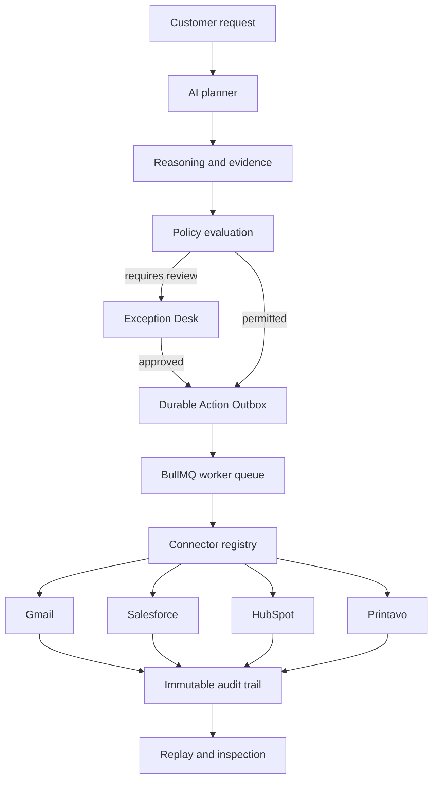

# Mission Control

> **Enterprise AI Agent Control Plane**

Mission Control helps engineering teams safely operate AI agents that take real
business actions. It turns an agent’s proposed customer-facing action into a
governed, inspectable workflow with policy enforcement, human approval,
idempotency, replay, and auditability.

Enterprise AI agents need more than reasoning and tool calls. They need a
reliable control plane that can answer: *why did the agent decide this, who
approved it, can it execute only once, and can we recover safely when it fails?*

## The product in 60 seconds

Mission Control follows a customer request from the moment an AI planner
understands it until a governed business action reaches a connector boundary.

```text
Customer request → Planner → Reasoning → Policy → Human approval
                 → Durable outbox → Worker → Connector → Audit → Replay
```

The included Northstar Logistics scenario demonstrates a renewal-email request.
The agent gathers context, proposes a response, is stopped by commercial-policy
controls, and awaits an authorized operator. Once approved, the action receives
a durable idempotency key and can be claimed once by a connector worker.

Mission Control never fabricates an external delivery. When a connector has no
credentials, it fails closed at the connector boundary rather than claiming an
email, CRM update, or order was completed.

## Demo

Capture these screens for a GitHub demo GIF or screenshot carousel:

| Screen | What it proves |
| --- | --- |
| Live Timeline | The customer request, planner, reasoning, and policy gate are one execution. |
| Agent Brain | Engineers can inspect the selected action and rejected alternatives. |
| Exception Desk | High-risk work is routed to an authorized human with evidence. |
| Action Outbox | Approval produces a durable action with a stable idempotency key. |
| Replay | The complete execution can be inspected after the fact. |

See [FOUNDER_DEMO.md](FOUNDER_DEMO.md) for the exact five-minute click path and
Loom narration.

## Founder demo workflow

1. A Northstar Logistics customer renewal request enters the execution timeline.
2. The planner builds a response using customer context and business rules.
3. Policy recognizes commercially sensitive claims and blocks the action.
4. An operator reviews the evidence in Exception Desk and approves the action.
5. Mission Control writes a durable outbox record with a project-scoped
   idempotency key.
6. A worker may claim the action exactly once and reaches the Gmail connector
   boundary.
7. Without configured provider credentials, the connector throws
   `ConnectorNotConfiguredError`; Mission Control records no invented success.
8. The timeline, approval, outbox record, and audit history remain replayable.

## Architecture



## Core capabilities

### Policy-gated approvals

High-risk business actions are stopped before execution. Authorized operators
can approve, reject, or escalate using project-scoped RBAC and optimistic
concurrency protection.

### Durable Action Outbox

Each action is persisted before execution with a project-scoped idempotency key,
payload hash, version, retry state, and external-reference field. The outbox is
the boundary between AI intent and a real business side effect.

### Fail-closed connector registry

Gmail, Salesforce, HubSpot, and Printavo connector interfaces are registered
through dependency injection. Unconfigured connectors throw
`ConnectorNotConfiguredError`; they never return fake provider IDs or success.

### Replay and inspection

Engineers can follow the customer request through timeline events, reasoning,
memory retrieval, decisions, policy evidence, approval history, and replay.

### Enterprise controls

Project-scoped authorization, immutable audit logs, PostgreSQL control-plane
state, typed tRPC APIs, and deterministic seed scenarios provide a safe base
for production workflow execution.

## Original engineering contributions

Mission Control adds original control-plane capabilities on top of reusable
open-source infrastructure:

- Exception Desk with durable human decisions and optimistic concurrency.
- Policy-gated Northstar Logistics approval flow.
- `AgentAction` and immutable `AgentActionAttempt` control-plane records.
- Project-scoped idempotency and action payload hashing.
- Explicit action state machine and retry/reconciliation classification.
- Fail-closed Gmail, Salesforce, HubSpot, and Printavo connector contracts.
- Run Workbench Outbox experience and deterministic founder-demo scenario.

The application reuses generic capabilities such as authentication, multi-tenant
RBAC, tables, replay rendering, queue infrastructure, database access, and UI
primitives. It does not claim those inherited components as original work.

## Technology stack

| Layer | Technology |
| --- | --- |
| Web | Next.js, React, TypeScript, Tailwind CSS, tRPC |
| Control plane | Prisma and PostgreSQL |
| Event and analytics data | ClickHouse |
| Async processing | BullMQ and Redis |
| Authentication | NextAuth and project-scoped RBAC |
| Inspection | Timeline, replay, trace rendering, React Flow |

## System architecture

- **Web:** user interface, authentication, project authorization, and typed API
  procedures.
- **Shared:** domain contracts, Prisma schema, repositories, queue contracts,
  connector interfaces, and control-plane logic.
- **Worker:** BullMQ consumers, scheduled processing, operational metrics, and
  connector dispatch boundary.
- **PostgreSQL:** mutable control-plane state, approvals, audit metadata, and
  durable outbox records.
- **ClickHouse:** high-volume execution telemetry used by timeline and replay.

## Project structure

```text
web/                         Next.js UI and tRPC API
worker/                      BullMQ workers and background processors
packages/shared/             Prisma, domain contracts, repositories, queues
packages/shared/prisma/      Control-plane schema and migrations
packages/shared/scripts/     Deterministic seed scenarios
FOUNDER_DEMO.md              Five-minute founder demo script
```

## Local setup

```bash
pnpm install
pnpm run infra:dev:up
pnpm run db:generate
pnpm --filter @langfuse/shared run db:migrate
pnpm run seed -- sales-email-agent --v4
pnpm run dev
```

Open the seeded run URL printed by the seed command, then follow
[FOUNDER_DEMO.md](FOUNDER_DEMO.md).

## Environment variables

The web application requires standard infrastructure configuration:

```bash
DATABASE_URL=
DIRECT_URL=
NEXTAUTH_SECRET=
NEXTAUTH_URL=http://localhost:3000
SALT=
CLICKHOUSE_URL=
CLICKHOUSE_USER=
CLICKHOUSE_PASSWORD=
REDIS_CONNECTION_URL=
```

Connector credentials are intentionally optional. Without a configured provider,
the relevant connector fails closed with `ConnectorNotConfiguredError`.

Never commit `.env` files or production credentials.

## Demo scenario: Northstar Logistics

Northstar Logistics sends a renewal-related customer request. The seeded agent
plans a response, retrieves account context, validates contract information,
and proposes a customer email. A commercial-claims policy requires manager
approval before delivery. The resulting action is visible in Outbox with its
stable idempotency key and audit history.

## Roadmap

- Configure real provider adapters and verified dispatch/reconciliation.
- Add durable workflow execution and worker claim lifecycle.
- Expand policy controls for confidence, value, compliance, and customer data.
- Add action-level execution analytics and operational SLAs.
- Publish a connector SDK and customer workflow templates.

## License and attribution

Mission Control contains original control-plane work built on the
[Langfuse](https://github.com/langfuse/langfuse) open-source project. The
upstream project provides reusable observability and platform infrastructure;
Mission Control additions are documented above. Consult the repository’s
upstream license notices for inherited code and dependencies.
